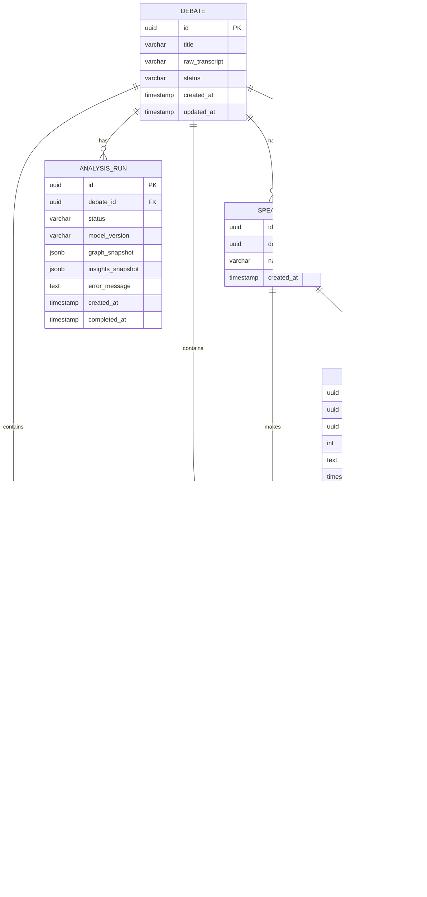

# ARGUMAP — Database Schema & Data Models Specification

* **Document Version:** 1.0.0
* **Target Engine:** PostgreSQL 15+
* **ORM:** SQLAlchemy v2 (Declarative Mapping)

---

## 1. Entity-Relationship Overview

ARGUMAP's relational schema captures the complete hierarchical structure of a debate: from the top-level debate session down to speakers, speech turns, segmented argument propositions, relational dependency edges, and versioned analysis executions.

### 1.1 Mermaid Entity-Relationship Diagram



---

## 2. Relational Entity Definitions

### 2.1 Table: `debates`
Stores top-level debate sessions, raw transcripts, and lifecycle state.

| Column | Type | Constraints | Description |
| :--- | :--- | :--- | :--- |
| `id` | `UUID` | Primary Key, default `gen_random_uuid()` | Unique debate identifier. |
| `title` | `VARCHAR(255)` | Not Null | Descriptive title or motion of the debate. |
| `raw_transcript`| `TEXT` | Not Null | Original unaltered transcript as submitted by user. |
| `status` | `VARCHAR(32)` | Not Null, Default `'PENDING'` | Status: `PENDING`, `PROCESSING`, `COMPLETED`, `FAILED`. |
| `created_at` | `TIMESTAMP WITH TIME ZONE` | Not Null, Default `CURRENT_TIMESTAMP` | Ingestion timestamp. |
| `updated_at` | `TIMESTAMP WITH TIME ZONE` | Not Null, Default `CURRENT_TIMESTAMP` | Last updated timestamp. |

### 2.2 Table: `speakers`
Normalizes individual speakers participating in a debate.

| Column | Type | Constraints | Description |
| :--- | :--- | :--- | :--- |
| `id` | `UUID` | Primary Key, default `gen_random_uuid()` | Unique speaker identifier. |
| `debate_id` | `UUID` | Foreign Key $\rightarrow$ `debates(id)` ON DELETE CASCADE | Debate context. |
| `name` | `VARCHAR(128)`| Not Null | Normalized speaker display name (e.g., "Speaker A"). |
| `created_at` | `TIMESTAMP WITH TIME ZONE` | Not Null, Default `CURRENT_TIMESTAMP` | Creation timestamp. |

*Unique Index:* `(debate_id, name)` ensures speaker names are unique within a debate session.

### 2.3 Table: `turns`
Captures chronological speech turns belonging to a speaker.

| Column | Type | Constraints | Description |
| :--- | :--- | :--- | :--- |
| `id` | `UUID` | Primary Key, default `gen_random_uuid()` | Unique turn identifier. |
| `debate_id` | `UUID` | Foreign Key $\rightarrow$ `debates(id)` ON DELETE CASCADE | Debate context. |
| `speaker_id`| `UUID` | Foreign Key $\rightarrow$ `speakers(id)` ON DELETE CASCADE | Attributed speaker. |
| `turn_order`| `INTEGER` | Not Null | Sequential index of turn within debate ($1, 2, 3, \dots$). |
| `text` | `TEXT` | Not Null | Complete text of the turn. |
| `created_at` | `TIMESTAMP WITH TIME ZONE` | Not Null, Default `CURRENT_TIMESTAMP` | Creation timestamp. |

*Unique Index:* `(debate_id, turn_order)` guarantees strictly ordered turns without collision.

### 2.4 Table: `arguments`
Represents individual segmented argument units (propositions) classified with one of the 6 frozen component labels.

| Column | Type | Constraints | Description |
| :--- | :--- | :--- | :--- |
| `id` | `UUID` | Primary Key, default `gen_random_uuid()` | Unique argument unit identifier. |
| `debate_id` | `UUID` | Foreign Key $\rightarrow$ `debates(id)` ON DELETE CASCADE | Debate context. |
| `turn_id` | `UUID` | Foreign Key $\rightarrow$ `turns(id)` ON DELETE CASCADE | Turn from which unit was segmented. |
| `speaker_id`| `UUID` | Foreign Key $\rightarrow$ `speakers(id)` ON DELETE CASCADE | Speaker who stated the unit. |
| `text` | `TEXT` | Not Null | Extracted proposition text. |
| `component_type`| `VARCHAR(32)` | Not Null, CHECK constraint | Frozen label: `CLAIM`, `PREMISE`, `EVIDENCE`, `COUNTERARGUMENT`, `REBUTTAL`, `OTHER`. |
| `confidence`| `FLOAT` | Not Null, CHECK `confidence BETWEEN 0.0 AND 1.0` | Model classification confidence score. |
| `start_char`| `INTEGER` | Not Null | Character start offset within parent turn text. |
| `end_char` | `INTEGER` | Not Null | Character end offset within parent turn text. |
| `created_at` | `TIMESTAMP WITH TIME ZONE` | Not Null, Default `CURRENT_TIMESTAMP` | Creation timestamp. |

*Check Constraint:*
```sql
CHECK (component_type IN ('CLAIM', 'PREMISE', 'EVIDENCE', 'COUNTERARGUMENT', 'REBUTTAL', 'OTHER'))
```

### 2.5 Table: `relations`
Represents directed relational links connecting two argument units.

| Column | Type | Constraints | Description |
| :--- | :--- | :--- | :--- |
| `id` | `UUID` | Primary Key, default `gen_random_uuid()` | Unique relation identifier. |
| `debate_id` | `UUID` | Foreign Key $\rightarrow$ `debates(id)` ON DELETE CASCADE | Debate context. |
| `source_argument_id` | `UUID` | Foreign Key $\rightarrow$ `arguments(id)` ON DELETE CASCADE | Directed source unit ($u_A$). |
| `target_argument_id` | `UUID` | Foreign Key $\rightarrow$ `arguments(id)` ON DELETE CASCADE | Directed target unit ($u_B$). |
| `relation_type` | `VARCHAR(32)` | Not Null, CHECK constraint | Frozen label: `SUPPORTS`, `ATTACKS`, `RESPONDS_TO`, `NO_RELATION`. |
| `confidence`| `FLOAT` | Not Null, CHECK `confidence BETWEEN 0.0 AND 1.0` | Relation classification confidence. |
| `created_at` | `TIMESTAMP WITH TIME ZONE` | Not Null, Default `CURRENT_TIMESTAMP` | Creation timestamp. |

*Check Constraints:*
```sql
CHECK (relation_type IN ('SUPPORTS', 'ATTACKS', 'RESPONDS_TO', 'NO_RELATION'))
CHECK (source_argument_id <> target_argument_id) -- No self-loops
```

### 2.6 Table: `analysis_runs`
Tracks versioned pipeline executions, model identifiers, execution timing, and complete serialized graph snapshots.

| Column | Type | Constraints | Description |
| :--- | :--- | :--- | :--- |
| `id` | `UUID` | Primary Key, default `gen_random_uuid()` | Unique analysis run identifier. |
| `debate_id` | `UUID` | Foreign Key $\rightarrow$ `debates(id)` ON DELETE CASCADE | Associated debate. |
| `status` | `VARCHAR(32)` | Not Null, Default `'QUEUED'` | Run status: `QUEUED`, `PROCESSING`, `COMPLETED`, `FAILED`. |
| `model_version` | `VARCHAR(64)` | Not Null | Identifiers of models used (e.g. `v1-baseline`, `v1-transformer`). |
| `graph_snapshot` | `JSONB` | Nullable | Serialized React Flow graph nodes and edges for instant retrieval. |
| `insights_snapshot`| `JSONB`| Nullable | Cached structural reasoning insights array. |
| `error_message` | `TEXT` | Nullable | Traceback or reason if status is `FAILED`. |
| `created_at` | `TIMESTAMP WITH TIME ZONE` | Not Null, Default `CURRENT_TIMESTAMP` | Run start timestamp. |
| `completed_at` | `TIMESTAMP WITH TIME ZONE` | Nullable | Run completion timestamp. |

---

## 3. Relational Integrity & Cascades

1. **Top-Level Cascade:** Deleting a `debate` automatically deletes all child `speakers`, `turns`, `arguments`, `relations`, and `analysis_runs` via `ON DELETE CASCADE`.
2. **Turn Deletion:** Deleting a `turn` cascades down to all its segmented `arguments`.
3. **Argument Deletion:** Deleting an `argument` cascades to all `relations` where it functions as either `source_argument_id` or `target_argument_id`, preserving graph validity.
4. **Self-Loop Prevention:** A database check constraint enforces `source_argument_id <> target_argument_id`.

---

## 4. ML-to-Graph Serialized Schema (JSON / React Flow Interface)

When an analysis run finishes, the backend compiles a fully serialized JSON structure stored in `analysis_runs.graph_snapshot` and delivered to the frontend client.

### 4.1 Schema Definition
* **`debate_id`** (`string`): UUID of the debate.
* **`speakers`** (`array`): List of speaker objects (`id`, `name`).
* **`arguments`** (`array`): List of argument objects containing proposition text, metadata, and the React Flow `graph_node` payload.
* **`relations`** (`array`): List of relation objects containing source, target, relation label, and the React Flow `graph_edge` payload.
* **`insights`** (`array`): Structural reasoning insights discovered by the topological analysis engine.

### 4.2 React Flow Mapping Contract

```typescript
// TypeScript Interface Definitions

export type ComponentType = 
  | 'CLAIM' 
  | 'PREMISE' 
  | 'EVIDENCE' 
  | 'COUNTERARGUMENT' 
  | 'REBUTTAL' 
  | 'OTHER';

export type RelationType = 
  | 'SUPPORTS' 
  | 'ATTACKS' 
  | 'RESPONDS_TO' 
  | 'NO_RELATION';

export interface SpeakerData {
  id: string;
  name: string;
}

export interface ArgumentNodeData {
  label: string;
  component_type: ComponentType;
  speaker_id: string;
  speaker_name: string;
  confidence: number;
  turn_order: number;
}

export interface ArgumentGraphNode {
  id: string;
  type: 'argumentNode';
  position: { x: number; y: number };
  data: ArgumentNodeData;
}

export interface RelationEdgeData {
  relation_type: RelationType;
  confidence: number;
}

export interface RelationGraphEdge {
  id: string;
  source: string;
  target: string;
  type: 'argumentEdge';
  label: RelationType;
  animated: boolean;
  data: RelationEdgeData;
}

export interface StructuralInsight {
  id: string;
  type: 'UNSUPPORTED_CLAIM' | 'UNANSWERED_COUNTERARGUMENT' | 'DIRECT_CLASH' | 'ORPHAN_EVIDENCE';
  severity: 'INFO' | 'WARNING' | 'ALERT';
  message: string;
  related_argument_ids: string[];
}

export interface GraphAnalysisPayload {
  debate_id: string;
  analysis_id: string;
  status: 'PENDING' | 'PROCESSING' | 'COMPLETED' | 'FAILED';
  speakers: SpeakerData[];
  arguments: {
    id: string;
    turn_id: string;
    speaker_id: string;
    text: string;
    component_type: ComponentType;
    confidence: number;
    turn_order: number;
    graph_node: ArgumentGraphNode;
  }[];
  relations: {
    id: string;
    source_argument_id: string;
    target_argument_id: string;
    relation_type: RelationType;
    confidence: number;
    graph_edge: RelationGraphEdge;
  }[];
  insights: StructuralInsight[];
}
```
